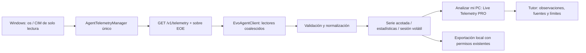

# EVO Observability Engine 1.0 · Entrega 1

## Flujo implementado

`evo-agent/src/observabilityProtocol.ts` es el contrato puro compartido por agente y navegador, sin dependencias Node en el bundle web. Esquema `1.0`, agente `1.1.0`. Campos por muestra: sesión, métrica, UTC, valor nullable, unidad, proveedor, intervalo real, validez, error, perdida/atrasada y versiones. El catálogo canónico de métricas y los límites viven allí; no se agregan registros al catálogo de laboratorios ni propietarios comerciales.

El agente conserva su sessionId de captura. Al normalizar se conserva como agentSessionId y se asigna a cada muestra el sessionId del registro experimental del navegador. sequence permite rechazar respuestas fuera de orden. Un salto de sequence puede provenir de otros lectores, por eso por sí solo no genera pérdida. Los saltos temporales producen un registro de discontinuidad sin interpolación. El frame indica timestampKind CAPTURE o CAPTURE_ATTEMPT; los errores de transporte registran el UTC del intento local y fuente UNKNOWN, sin inventar el instante de una captura inexistente. Un reinicio del agente exige nuevo emparejamiento; un cambio de identidad de captura restablece el control de secuencia.

## Captura y compatibilidad

Se amplía el `AgentTelemetryManager` existente; no hay segundo servidor, motor ni puerto. Capturas concurrentes comparten una promesa. Cache mínimo de un segundo; muestreo de fondo legacy y GET comparten ese mismo recolector. El sampler legacy deja de funcionar tras 15 segundos sin lectores. EOE solamente solicita GET: pausa, abandono o cierre no dejan un nuevo timer de fondo en Windows. Una consulta ya iniciada tiene timeout y finaliza sin matar procesos usados por otros lectores.

- CPU global y hasta 256 procesadores lógicos: diferencias de tiempos `os.cpus()`. Primera muestra/cambio de topología/reset: null, no cero. CPU total considera todos los procesadores aunque se limite el detalle.
- Memoria física/disponible/usada: Node OS; ocupación física es una proporción derivada, no PSI ni un diagnóstico. Compromiso/límite: proveedor CIM de memoria.
- Disco: actividad agregada a partir del idle, bytes/s formateados y latencias con diferencias de contador raw PERF_AVERAGE_TIMER. Se preservan intervalo, proveedor y evidencia raw (ticks, bases y frecuencia) de las latencias válidas; el navegador vuelve a calcular la fórmula y rechaza incoherencias. JSON y CSV permiten reproducirla; sin denominador positivo/operaciones completadas: UNKNOWN.
- Red: suma de tasas CIM de hasta 64 interfaces. Sin interfaces o límite excedido: UNKNOWN. Las interfaces virtuales pueden contar tráfico más de una vez; no se afirma que sea ancho de banda de Internet.
- Procesos: unión de top cinco por CPU y top cinco por working set privado, PID único. La CPU del proveedor puede exceder 100% porque suma procesadores lógicos.
- Autocosto: CPU/RSS del proceso Node; CPU acumulada y RSS puntual de PowerShell aparte; duración real de consulta. No se confunden con CPU total de la interfaz ni RAM pico del sistema.

PowerShell ejecuta exclusivamente un script constante con execFile y EncodedCommand, sin interpolar parámetros HTTP, sin elevación ni cambios a servicios/drivers. Consultas con timeout 4 s, salida máxima 512 KiB, un proceso de captura a la vez. Los grupos de contadores fallan de forma independiente; una ausencia no invalida CPU/memoria disponibles. Fallar el proceso completo conserva la duración de consulta y deja sus contadores UNKNOWN. En Linux el sobre informa plataforma incompatible y el navegador lo rechaza; no se etiqueta al host Linux como el Windows del usuario.

Los campos legacy de `/v1/telemetry` se conservan. CPU ahora admite null para no fabricar el primer 0; el único ajuste en Windows X-Ray es mostrar UNKNOWN en ese caso. No cambian sus motores, escenarios ni progreso. Los endpoints de inventario, servicios y experimentos allowlisted siguen disponibles autenticados. EOE nunca invoca experimentos del sistema.

## Seguridad y migración

La base auditada **no tenía emparejamiento por código**, aunque el pedido lo daba por supuesto. `/health`, sus dos alias y los logs exponían credenciales o prefijos. Se elimina esa entrega. El emparejamiento ahora exige el código de la consola local: seis dígitos aleatorios, cinco minutos, un uso, rotación garantizada a otro código y cinco intentos por minuto como máximo. Máximo ocho sesiones por agente. Tokens aleatorios de 256 bits, comparación constante por bytes, vencimiento ocho horas, ligados al Origin y revocables. No se guardan en localStorage ni se exportan. CLI sin Origin usa un espacio de sesión distinto del navegador.

Se conserva la allowlist de dos URL exactas y localhost, restringiendo Origin a una URL serializada http(s), sin paths ni wildcards. Host local validado para prevenir rebinding. CORS preflight de red privada se autoriza solamente después de validar Origin y Host. El navegador o Windows todavía pueden exigir autorización de red local; no se evitan esas protecciones. Credenciales, códigos e inventarios no aparecen en health/capabilities. Clientes antiguos deben actualizarse a la vez: no se ofrece fallback al handshake inseguro.

No cambian Firebase, pagos ni entitlements. La exportación consulta `canAccess({ type: 'telemetry_download' })`, como prescribe el sistema actual; FREE recibe el paywall existente. El nuevo centro no abre laboratorios premium ni modifica sus permisos.

## Sesión, recursos y presentación

`ObservabilityEngine` es compartido; un solo ciclo, sin solicitudes superpuestas. AbortController cancela el lector cuando se pausa o abandona. EvoAgentClient comparte transporte con consumidores legacy: cancelar un suscriptor no interrumpe otro; al salir el último se cancela HTTP. Configuración segura 1–10 s de captura, 0.5–5 s de publicación visual; perfil juegos 5/2 s. Una consulta lenta impone un descanso antes del siguiente intento; se informa el intervalo observado, no se promete una frecuencia imposible. Errores recuperables reintentan con espera; falta de emparejamiento/esquema/plataforma pausa explícitamente.

Serie volátil: máximo 300 frames, 8 MiB de JSON UTF-8 compacto y ventana de 15 minutos al ingresar nuevos registros. Se descarta lo más antiguo y se informa el contador de retirados. Pausar conserva el registro para exportarlo; descartarlo libera la serie. No hay IndexedDB, Firestore ni persistencia automática. La RAM real incluye objetos, React y runtime y puede ser mayor al presupuesto de JSON. No se agrega un módulo de almacenamiento permanente.

Validación rechaza identidad, unidades y fuentes incompatibles, duplicados, métricas no registradas, valores no finitos/negativos y timestamps inválidos. Stale > max(10 s, 3 períodos) se vuelve null/error; adelanto > 2 min se rechaza. Las razones quedan visibles. Series SVG con UTC/unidades, ventana 30/60/300 s, inspección por puntero y teclado, huecos sin interpolar. Estadística de los valores válidos retenidos: mínimo, máximo, media aritmética y percentiles nearest-rank P50/P95; no es media ponderada por tiempo. Muestras atrasadas válidas conservan su hora real y participan; perdidas/erróneas se excluyen.

Tres niveles consultan la misma fuente. Captura opt-in; pausa al ocultar documento o abandonar el centro; requiere reanudación explícita. Exportación JSON/CSV local con fuentes/calidad; CSV evita fórmulas y JSON no incluye respuestas de emparejamiento ni tokens. Nombres de procesos figuran solo en JSON si el usuario autorizado decide exportar. Tutor recibe contexto de observaciones y ausencia de datos; sin llamadas nuevas de IA ni afirmaciones de diagnóstico.

## Alcance pendiente

No se desarrollan seis motores adelantados. Persistencia opt-in, agregación de muestras antiguas, comparación A/B y Time Machine corresponden a Entrega 2. Alertas (incluyendo sus pruebas), correlaciones/eventos, hipótesis de cuello de botella, anomalías y Explain My PC completo esperan las entregas posteriores. No se declara integración Windows aprobada sin ejecución en Windows real.
